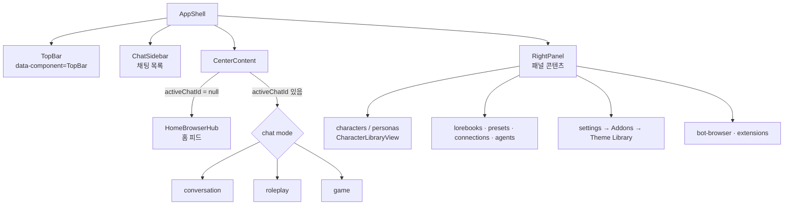
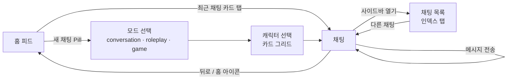
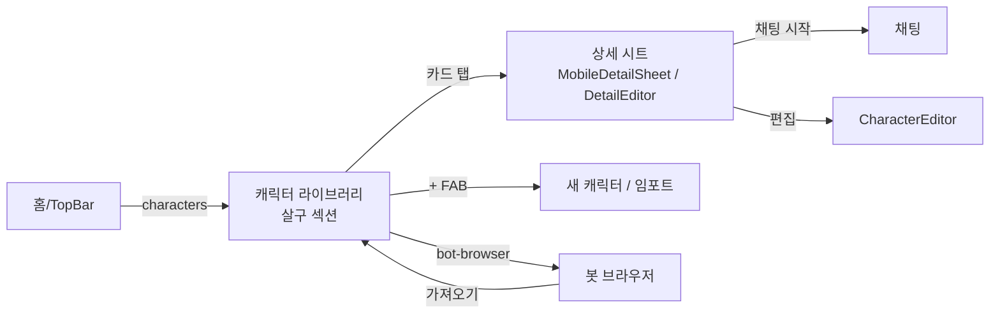
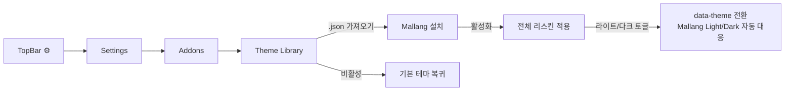

# Mallang UI — Marinara Engine v2.5.1 테마 UX 플로우

> 대상: Marinara Engine **v2.5.1** (React 19 + Tailwind v4, 라우터 없이 zustand `Panel` 상태로 화면 전환)
> 레퍼런스: 크림/세이지 톤(구름 로그인), nonDo식 굵은 외곽선 카드, 인덱스 탭, 파스텔 섹션 컬러, 손그림 스케치 라인, 게임형 Core/Meta 플로우

---

## 0. 구현 방식 (MARINARA98 분석 반영)

> 정정: 초안에서는 "확장으로는 앱을 리스킨할 수 없다"고 썼다. 이는 **샌드박스 확장에 한한 이야기**였다. `capabilities: ["full_page_access"]`를 주면 확장이 iframe 밖에서 돌아가므로 CSS와 JS로 앱 전체를 바꿀 수 있다. MARINARA98이 이 방식을 쓴다.

| 방식 | 할 수 있는 것 | 비용 |
|---|---|---|
| Custom Theme (CSS만) | 색과 모양 | 요소 추가 불가. 외부 `url()`과 폰트 금지 |
| **External Extension + `full_page_access`** | CSS 주입, 새 DOM(하단 탭바, 위젯), 앱 데이터 읽기 | 설치 문턱이 높다: `.env`의 `ENABLE_EXTERNAL_EXTENSIONS`, 위험 구역 설정, 해시 승인 |

**결정: MARINARA98과 같은 External Extension 1개로 만든다.**

```json
{
  "kind": "marinara.personal-extension", "version": 1,
  "config": {
    "name": "Mallang", "version": "0.1.0", "runtime": "client",
    "capabilities": ["full_page_access"],
    "jsPath": "mallang.js", "cssPath": "mallang.css"
  }
}
```

**MARINARA98에서 가져올 패턴**
- **CSS 256 KiB 한도.** 폰트는 CSS가 아니라 JS 안의 `data:` URL로 넣고 `<style id>`로 주입한다(MARINARA98 js:976-983).
- **정리 처리.** `listen()`으로 리스너를 등록해 두고, `marinara.onCleanup`에서 주입한 노드, `data-*` 속성, CSS 변수를 모두 제거한다(js:886, 2446).
- **저장.** `marinara.storage` 객체 하나에 `patch`를 debounce해서 쓴다. localStorage는 쓰지 않는다.
- **데이터는 읽기만.** `marinara.fetch("/api/chats" | "/api/characters")`로 가져오고, 쓰기는 하지 않는다.
- **채팅 전환.** 직접 API를 호출하지 않고 Marinara의 UI 버튼을 대신 클릭한다(js:1062). 안전하지만 앱 DOM이 바뀌면 깨지기 쉽다.

**MARINARA98에서 따라 하지 않을 것**
- **바탕화면, 작업 표시줄, 창 프레임 메타포.** 프레임 46px와 작업 표시줄 36px가 세로 공간을 먹는다. 작은 모니터에서는 치명적이다(§6).
- **700ms마다 `textarea[data-chat-id]`를 폴링하는 방식.** 대신 `[data-component="CenterContent"]`의 childList를 MutationObserver 하나로 관찰한다.
- **10–11px 도트 폰트.** 저DPI 노트북 화면에서는 가독성이 떨어진다. 본문 14px 이상을 유지한다.
- **CSS 토큰마다 `!important`.** 프리셋 inline style을 이기려고 붙인 것인데 필요한 이유는 이해된다. 다만 `--background` 등 핵심 토큰에만 한정한다.

**남은 제약**
- 홈 피드(`HomeBrowserHub`)에는 안정적인 훅이 없다. MARINARA98은 `.mari-home-*` 클래스를 쓰는데, 이 클래스들이 v2.5.1에 실제로 있는지 확인하는 점검표가 필요하다.
- `full_page_access`는 사용자 입장에서 "페이지 전체를 넘겨주는" 권한이다. 신뢰를 얻으려면 README에 하는 일과 하지 않는 일을 명시해야 한다.

---

## 1. 디자인 언어

**키워드:** 말랑(soft) + 또렷(outline). 바탕은 레퍼런스 1의 차분한 크림, 카드는 레퍼런스 2의 굵은 외곽선과 오프셋 그림자, 섹션 구분은 레퍼런스 6의 파스텔 컬러로 잡는다.

### 1.1 토큰 매핑 (Marinara 변수 → Mallang 값)

| Marinara 토큰 | Light | Dark | 메모 |
|---|---|---|---|
| `--background` | `#F5F3EA` 크림 | `#1E2128` | |
| `--foreground` | `#3E4A63` 잉크네이비 | `#E9E6DA` | 순수 검정은 쓰지 않는다 |
| `--card` | `#FFFFFF` | `#272B34` | 투명도 없음(기본값은 `d9` 알파) |
| `--primary` | `#4F5B7A` | `#C9D8CF` | 버튼과 선택 상태 |
| `--secondary` | `#D3DED6` 세이지 | `#34413A` | 큰 카드 바탕(레퍼런스 1 PROGRESS 영역) |
| `--accent` | `#F4C77B` 머스터드 | `#B8913F` | 뱃지, 알림, 활성 탭 |
| `--muted-foreground` | `#8A90A0` | `#9A9FAD` | |
| `--border` | `#2B2F3A` | `#0E1015` | **외곽선 전용**, 2px |
| `--radius` | `1.25rem` | 동일 | 기본값 `.75rem`보다 둥글게 |
| `--destructive` | `#E88A7E` 코랄 | `#E88A7E` | |
| `--marinara-app-accent-gradient` | `linear-gradient(90deg,#F5F3EA,#CFE0EC)` | 어두운 버전 | 레퍼런스 1의 "Log In" 버튼 그라데이션 |

**섹션 파스텔:** 패널마다 다른 색을 써서 위치를 알려 준다(레퍼런스 6).

| 패널 | 색 | Hex |
|---|---|---|
| chat | 세이지 | `#CFE3D4` |
| characters | 살구 | `#F6CFC0` |
| personas | 라벤더 | `#DAD3EE` |
| lorebooks | 버터 | `#F6E7B4` |
| presets / connections / agents | 하늘 | `#CFE0EC` |
| settings | 회색 | `#E4E2DA` |

### 1.2 공통 컴포넌트 규칙
- **Mallang Card:** `border: 2px solid var(--border)`, `box-shadow: 3px 4px 0 var(--border)`, 라운드는 `var(--radius)`. 누르면 `translate(2px,3px)`와 함께 그림자가 줄어들어 "눌리는" 느낌을 준다.
- **Pill 버튼:** 높이 44px 이상, 완전 라운드, 그라데이션 배경. 주요 CTA에만 쓴다.
- **Stat Tile:** 큰 숫자(32–48px, 700)와 작은 대문자 라벨. 레퍼런스 1의 `25 / 8` 패턴이다.
- **Dot Track:** 7칸짜리 사각 점 트랙(레퍼런스 2의 Habit). 최근 채팅 활동을 표시한다(CSS로만 가능한 범위 안에서 장식용).
- **스케치 장식:** 모서리에 손그림 SVG를 `data:` URI 배경으로 단다(레퍼런스 5). 히어로 카드 1~2곳에만 쓴다.
- **폰트:** 외부 폰트는 금지라서 `data:` woff2를 인라인해야 한다. 한글 폰트를 통째로 넣으면 MB 단위가 되므로 **v1에서는 시스템 폰트 스택을 쓰고**, 숫자와 제목에만 서브셋 라틴 폰트(~20KB)를 고려한다.

---

## 2. 정보 구조 (Marinara 실제 구조 기준)



레퍼런스 7의 게임 UX를 빌려 **Core(매일 반복하는 루프)**와 **Meta(가끔 들르는 관리 화면)**로 나눈다.

---

## 3. UX Flow: Core — 홈에서 대화하고 다시 홈으로



### 3.1 홈 피드 (HomeBrowserHub) — 레퍼런스 1·2·4·6
```
┌─────────────────────────────┐
│ ☁  Good evening, {persona}  │ ← 인사와 구름 마스코트(data: SVG)
│ Thu · 11월 4일               │
├─────────────────────────────┤
│ [ + 새 채팅 시작 ]  (Pill)    │ ← HomeNewChatLauncher
├─────────────────────────────┤
│ ╭ Continue ─────────── 3 › ╮ │ ← RecentChats → nonDo Inbox 카드
│ │ ○ 리나   "그럼 내일…"  2m │ │
│ │ ○ 탐정단 "단서를…"     1h │ │
│ ╰───────────────────────────╯ │
│ ╭─────╮ ╭─────╮ ╭─────╮       │ ← Stat Tile 3개
│ │ 12  │ │  5  │ │  3  │       │   (채팅 / 캐릭터 / 업적)
│ │Chats│ │Chars│ │Badge│       │
│ ╰─────╯ ╰─────╯ ╰─────╯       │
│ ╭ Characters ────────── › ╮  │ ← HomeCharacterLibrary
│ │ ◯ ◯ ◯ ◯  가로 스크롤      │  │   (살구색 섹션)
│ ╰─────────────────────────╯  │
│ ╭ Calendar ─────────────── ╮ │ ← HomeClockCalendar
│ │ Su Mo Tu We (Th) Fr Sa   │ │   레퍼런스 1의 주간 스트립
│ ╰──────────────────────────╯ │
└─────────────────────────────┘
```
- 위젯 순서는 Marinara의 `FeedModule` 설정을 따른다. 테마는 **모양만** 바꾸고 순서와 노출 여부는 바꾸지 않는다(CSS에서 `order`를 쓰면 접근성 순서가 꼬인다).
- 상태별 화면:
  - **빈 상태:** 채팅이 0개면 구름 마스코트와 "첫 대화를 시작해 볼까요?"를 보여 준다. 다만 CSS만으로는 텍스트를 바꿀 수 없다. `::after`에 `content`를 넣으면 i18n이 깨지므로 **문구는 원본 그대로 둔다.**
  - **로딩:** 카드 외곽선은 그대로 두고 내부만 shimmer로 처리한다.

### 3.2 채팅 화면
| 모드 | 스타일 |
|---|---|
| conversation `[data-chat-mode="conversation"]` | 메신저형. 유저 말풍선은 `--primary` 채움, 캐릭터 말풍선은 흰 카드에 2px 외곽선. 그룹 메시지(`[data-grouped]`)는 그림자 생략 |
| roleplay `[data-chat-mode="roleplay"]` | 문서형. 말풍선 없이 넓은 카드 1장에 행간 1.75 |
| game | **건드리지 않는다.** 자체 UI 밀도가 높아 깨질 위험이 크다. 토큰 색만 상속한다 |

- **입력창** (`[data-chat-composer]`, `.marinara-chat-input-shell`): 레퍼런스 2 하단처럼 `(+)` 원형 버튼과 라운드 입력 필드를 둔다.
- **툴바와 팝오버** (`.marinara-chat-toolbar-button`, `.marinara-chat-popover`): Mallang Card 규칙을 적용한다.
- **카드 CSS** `[data-card-css]` 메시지는 캐릭터 제작자의 스타일을 우선해야 하므로 **Mallang 규칙에서 제외한다**(`:not([data-card-css])`).

### 3.3 채팅 목록 (ChatSidebar) — 레퍼런스 3
- 모드 탭(`[data-chat-mode-tab]`)은 세로 인덱스 탭처럼 보이게 하고 모드마다 파스텔 색을 준다.
- 행(`[data-chat-id]`)에는 원형 체크 대신 아바타, 제목, 마지막 시각을 두고 구분선은 점선으로 한다.
- 폴더(`[data-chat-folder-id]`)는 접힘 카드와 개수 뱃지(레퍼런스 2의 `Inbox 6 ›`)로 표현한다.

---

## 4. UX Flow: Meta — 캐릭터와 페르소나 관리


- **라이브러리 그리드** (`[data-component="CharacterLibraryView"]`): 2열(모바일)에서 4–5열(데스크톱)로 늘어난다. 카드 위쪽 60%는 이미지, 아래는 이름과 태그 칩이다. 레퍼런스 4의 Task Progress 카드 리듬을 따른다.
- **상세 시트:** 상단 이미지 뒤에 Stat Tile(메시지 수, 마지막 대화)을 두고, 하단에 Pill CTA "대화하기"를 고정한다.
- **FAB:** 레퍼런스 3의 우하단 원형 `+`. 단, Marinara에 원래 있는 버튼만 재배치할 수 있다. **없는 FAB은 만들 수 없다.**

## 5. UX Flow: Meta 2 — 설정과 테마 설치


- **설정 화면** (`[data-component="RightPanel"]`, `.mari-right-panel-*`): 섹션마다 Mallang Card를 쓰고, 헤더 아이콘은 회색 섹션 색으로 맞춘다.
- **모달과 윈도우** (`[data-component="Modal"]`, `.mari-window`, `.mari-drawer`): 2px 외곽선과 오프셋 그림자. 헤더는 세이지색 띠로 처리한다.
- **설치 온보딩:** 테마 안에서는 화면을 만들 수 없다. 레포 README에 3단계 GIF를 넣는 것으로 대신한다.

---

## 6. 작은 모니터 우선 레이아웃

**기준 해상도:** 1366×768 / 1280×720 노트북. 브라우저 UI를 빼면 실제 뷰포트는 약 **1280×620**이다. 높이가 가장 큰 제약이므로 **세로 크롬(상단과 하단 고정 UI)을 최소화한다.**

### 6.1 세로 예산 (뷰포트 높이 620px 기준)
| 영역 | Marinara 기본 | MARINARA98 | **Mallang** |
|---|---|---|---|
| TopBar | 48 | 48 | **40** |
| 창 프레임(제목·상태) | 0 | 46 | **0** |
| 작업 표시줄 | 0 | 36 | **0** (데스크톱에는 하단 바 없음) |
| 입력창(1줄) | ~64 | ~70 | **52** |
| **메시지 영역** | ~508 | ~420 | **~528** |

### 6.2 브레이크포인트 (너비와 높이를 같이 본다)
| 이름 | 조건 | 레이아웃 |
|---|---|---|
| `phone` | `max-width: 767px` | 패널 1개. **JS로 하단 탭바 주입**(높이 56, 아래 safe-area 포함) |
| `compact` | 768–1279px | 채팅 사이드바를 **아이콘 레일(64px)**로 접는다. 오른쪽 패널은 오버레이 시트로 띄운다 |
| `laptop` | 1280–1599px | 사이드바 240px, 채팅 영역 가변, 오른쪽 패널은 **기본 닫힘**. 열면 오버레이로 띄우고 고정(pin)은 옵션으로 둔다 |
| `wide` | ≥1600px | 사이드바 280, 채팅 최대 760, 오른쪽 패널 360 고정 |
| `short` | `max-height: 760px` (위와 중첩 적용) | 밀도 모드: 카드 패딩 16→10, Stat Tile 숫자 40→28, 홈 위젯 2열을 3열로, 오프셋 그림자 4→2px |

- **JS 감지:** `innerWidth` 비교 대신 `matchMedia`를 구독해서 `data-mallang-size`, `data-mallang-short`를 `:root`에 쓰고, CSS는 이 속성만 본다.
- **사용자 설정:** "밀도: 자동 / 편안 / 촘촘". 자동이면 위 표를 따른다.

### 6.3 작은 모니터 와이어 (laptop + short, 1280×620)
```
┌40─ ☁ Mallang   [홈][채팅][캐릭터][⚙]          🔍 ─────────┐
│ 사이드바 240      │ 채팅 (가변, 본문 최대 720 가운데 정렬)      │
│ ╭ 대화 ─── 12 › ╮│ 리나 · roleplay                      [⋯] │
│ │● 리나     2m  ││ ┌────────────────────────────┐          │
│ │○ 탐정단   1h  ││ │ 캐릭터 메시지 (카드)          │          │
│ │○ 카페     어제 ││ └────────────────────────────┘          │
│ ╰──────────────╯│            ┌──────────────┐               │
│ [+ 새 채팅]      │            │ 유저 메시지     │               │
│                  │ (+) [ 메시지 입력…           ] [보내기] 52 │
└──────────────────┴──────────────────────────────────────────┘
   오른쪽 패널(캐릭터·설정)은 오른쪽 위에서 360px 오버레이 시트로 띄우고 Esc로 닫는다
```

### 6.4 홈 피드 (laptop + short)
- 스크롤 없이 첫 화면에 들어와야 하는 것: **새 채팅 Pill, 최근 채팅 3개, Stat 3개.** 캘린더와 캐릭터 가로 스크롤은 첫 화면 아래로 밀려도 된다.
- 2열 그리드로 배치한다. 왼쪽은 Continue(최근 채팅), 오른쪽은 Stat과 Calendar를 쌓는다. 너비 1280에서 열당 약 480px다.

## 7. 내비게이션

| 뷰포트 | 처리 |
|---|---|
| laptop / wide | TopBar를 40px로 줄인다. 아이콘 버튼(`[data-topbar-hover-key]`)은 원형으로 바꾸고 활성 상태는 `--accent` 채움으로 표시한다 |
| compact | TopBar와 왼쪽 아이콘 레일. 레일은 JS로 주입하고, 클릭하면 기존 TopBar 버튼을 대신 클릭한다(MARINARA98 방식) |
| phone | **하단 탭바 주입**(홈, 채팅, 캐릭터, 설정). TopBar는 제목만 남긴다. `AppShell.tsx:134`의 오버레이 top 오프셋과 `data-mari-software-keyboard-open` 대응이 **필수**다. 키보드가 열리면 탭바를 숨긴다 |

---

## 8. 구현 셀렉터 우선순위 (안정성 순)
1. **CSS 변수 덮어쓰기:** 가장 안전하다. 전체 효과의 약 70%를 여기서 낸다.
2. **`data-component` / `data-chat-mode` / `data-message-role` 등 data 속성:** 비교적 안전하다.
3. **`.mari-*` / `.marinara-*` 문서화된 클래스:** 안전하다(공식 문서에 있는 클래스).
4. **Tailwind 유틸 클래스 조합 셀렉터 (홈 피드):** **취약하다.** 별도의 `home.css` 블록으로 격리하고, 버전마다 점검표로 확인한다.

## 9. 파일 구조 제안
```
mallang-ui/
├─ src/
│  ├─ css/
│  │  ├─ tokens.css     # 변수 (light/dark)
│  │  ├─ density.css    # data-mallang-size / -short 별 밀도
│  │  ├─ components.css # 카드·Pill·모달·윈도우
│  │  ├─ chat.css       # 채팅·입력창·사이드바
│  │  ├─ library.css    # 캐릭터 라이브러리
│  │  └─ home.css       # 취약 셀렉터 격리
│  └─ js/
│     ├─ main.js        # 엔트리, cleanup 레지스트리
│     ├─ viewport.js    # matchMedia → data-mallang-*
│     ├─ nav.js         # 아이콘 레일 / 하단 탭바 주입
│     └─ assets.js      # SVG 아이콘, (선택) 폰트 data URL
├─ build.mjs            # → dist/Mallang/{manifest.json,mallang.css,mallang.js} + zip, CSS 256KiB 검사
└─ docs/UX-FLOW.md
```

## 10. 리스크 요약
- **`full_page_access`의 설치 문턱과 신뢰 문제.** 사용자 대부분은 `.env`를 수정하지 않는다. 목표 사용자층을 좁게 잡는다.
- **Marinara 업데이트 때 DOM이 바뀐다.** 홈 피드 셀렉터와 "버튼 대신 클릭" 로직이 가장 먼저 깨진다. 버전을 `2.5.1`로 고정하고 점검표를 둔다.
- **다른 전체 테마와 충돌한다.** MARINARA98과 동시에 켜면 깨진다. 시작할 때 `#m98-root`를 감지하면 경고를 띄운다.
- 2px 외곽선과 그림자가 game 모드나 카드 CSS와 충돌한다. 두 곳 모두 범위에서 제외한다.
- 크림 배경과 회색 텍스트 조합이 WCAG AA(4.5:1)에 못 미칠 수 있다. `--muted-foreground`는 실측 후 확정한다.
- 오버레이로 띄운 오른쪽 패널(laptop)이 채팅을 가린다. 예전처럼 고정해서 쓰던 사용자를 위해 고정(pin) 옵션을 둔다.
- 레퍼런스(nonDo, Dumi 등)의 로고, 마스코트, 레이아웃을 그대로 복제하지 않는다. 구름 마스코트는 새로 그린다.
