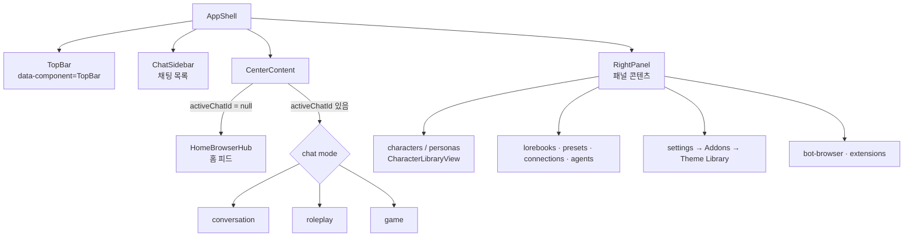
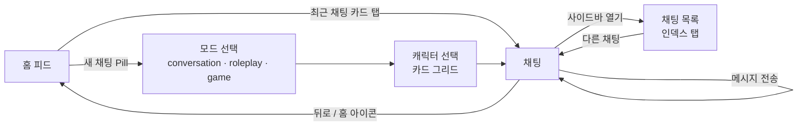
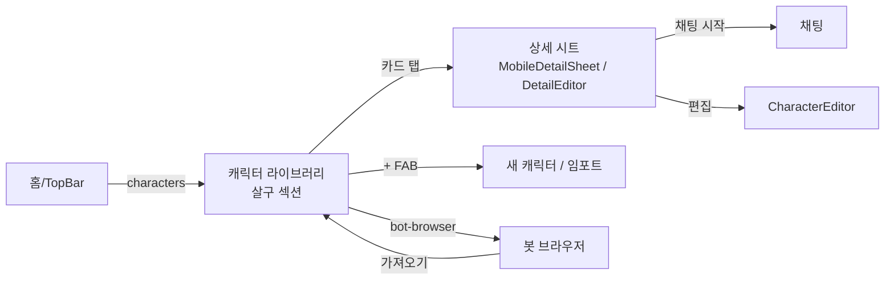
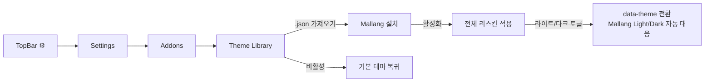

# Mallang UI — Marinara Engine v2.5.1 테마 UX 플로우

> 대상: Marinara Engine **v2.5.1** (React 19 + Tailwind v4, 라우터 없이 zustand `Panel` 상태로 화면 전환)
> 레퍼런스: 크림/세이지 톤(구름 로그인), nonDo식 굵은 외곽선 카드, 인덱스 탭, 파스텔 섹션 컬러, 손그림 스케치 라인, 게임형 Core/Meta 플로우

---

## 0. 먼저 알아야 할 제약 (중요)

| 항목 | 사실 | 결론 |
|---|---|---|
| Personal Extension | 샌드박스 iframe에서 동작하고 앱 DOM에 접근하지 못한다. 확장 CSS는 자기 창에만 적용된다 | **확장으로는 앱 전체 테마를 바꿀 수 없다** |
| Custom Theme | `<style id="marinara-custom-theme">`에 CSS가 주입된다. 활성 테마는 1개뿐이다 | **본체는 Theme(CSS)로 만든다** |
| 테마 sanitizer | `data:`가 아닌 `url()`, `@import`, 외부 폰트를 제거한다 | 이미지와 폰트는 모두 `data:` URI로 인라인한다. 용량에 주의한다 |
| 홈 피드 | `HomeBrowserHub`에 안정적인 `data-*` 훅이 거의 없다 | 홈 스타일링은 Tailwind 클래스 셀렉터에 기대야 하므로 **버전업 때 가장 먼저 깨진다** |
| 모바일 | 하단 탭바가 없고 TopBar만 있다 | CSS만으로 TopBar를 하단에 고정할 수는 있지만 요소를 추가할 수는 없다 |

**배포 형태 권장**
1. `mallang.theme.json` (`{ "name": "Mallang", "css": "..." }`): 실제로 앱 전체를 리스킨한다. 필수다.
2. (선택) `mallang-companion` Personal Extension: 사이드 패널에서 팔레트 프리셋 안내와 복사용 CSS 스니펫을 제공한다. 앱 DOM은 조작하지 못하므로 설명과 복사 용도만 가능하다. 하지만 `ENABLE_EXTERNAL_EXTENSIONS`, Danger Zone 설정, 해시 승인을 모두 거쳐야 해서 일반 사용자에게는 진입 장벽이 크다. **v1에서는 빼는 쪽을 권한다.**

---

## 1. 디자인 언어

**키워드:** 말랑(soft) + 또렷(outline). 바탕은 레퍼런스 1의 차분한 크림, 카드는 레퍼런스 2의 굵은 외곽선과 오프셋 그림자, 섹션 구분은 레퍼런스 6의 파스텔 컬러로 잡는다.

### 1.1 토큰 매핑 (Marinara 변수 → Mallang 값)

| Marinara 토큰 | Light | Dark | 메모 |
|---|---|---|---|
| `--background` | `#F5F3EA` 크림 | `#1E2128` | |
| `--foreground` | `#3E4A63` 잉크네이비 | `#E9E6DA` | 순수 검정은 쓰지 않는다 |
| `--card` | `#FFFFFF` | `#272B34` | 투명도 없음(기본값은 `d9` 알파) |
| `--primary` | `#4F5B7A` | `#C9D8CF` | 버튼과 선택 상태 |
| `--secondary` | `#D3DED6` 세이지 | `#34413A` | 큰 카드 바탕(레퍼런스 1 PROGRESS 영역) |
| `--accent` | `#F4C77B` 머스터드 | `#B8913F` | 뱃지, 알림, 활성 탭 |
| `--muted-foreground` | `#8A90A0` | `#9A9FAD` | |
| `--border` | `#2B2F3A` | `#0E1015` | **외곽선 전용**, 2px |
| `--radius` | `1.25rem` | 동일 | 기본값 `.75rem`보다 둥글게 |
| `--destructive` | `#E88A7E` 코랄 | `#E88A7E` | |
| `--marinara-app-accent-gradient` | `linear-gradient(90deg,#F5F3EA,#CFE0EC)` | 어두운 버전 | 레퍼런스 1의 "Log In" 버튼 그라데이션 |

**섹션 파스텔:** 패널마다 다른 색을 써서 위치를 알려 준다(레퍼런스 6).

| 패널 | 색 | Hex |
|---|---|---|
| chat | 세이지 | `#CFE3D4` |
| characters | 살구 | `#F6CFC0` |
| personas | 라벤더 | `#DAD3EE` |
| lorebooks | 버터 | `#F6E7B4` |
| presets / connections / agents | 하늘 | `#CFE0EC` |
| settings | 회색 | `#E4E2DA` |

### 1.2 공통 컴포넌트 규칙
- **Mallang Card:** `border: 2px solid var(--border)`, `box-shadow: 3px 4px 0 var(--border)`, 라운드는 `var(--radius)`. 누르면 `translate(2px,3px)`와 함께 그림자가 줄어들어 "눌리는" 느낌을 준다.
- **Pill 버튼:** 높이 44px 이상, 완전 라운드, 그라데이션 배경. 주요 CTA에만 쓴다.
- **Stat Tile:** 큰 숫자(32–48px, 700)와 작은 대문자 라벨. 레퍼런스 1의 `25 / 8` 패턴이다.
- **Dot Track:** 7칸짜리 사각 점 트랙(레퍼런스 2의 Habit). 최근 채팅 활동을 표시한다(CSS로만 가능한 범위 안에서 장식용).
- **스케치 장식:** 모서리에 손그림 SVG를 `data:` URI 배경으로 단다(레퍼런스 5). 히어로 카드 1~2곳에만 쓴다.
- **폰트:** 외부 폰트는 금지라서 `data:` woff2를 인라인해야 한다. 한글 폰트를 통째로 넣으면 MB 단위가 되므로 **v1에서는 시스템 폰트 스택을 쓰고**, 숫자와 제목에만 서브셋 라틴 폰트(~20KB)를 고려한다.

---

## 2. 정보 구조 (Marinara 실제 구조 기준)



레퍼런스 7의 게임 UX를 빌려 **Core(매일 반복하는 루프)**와 **Meta(가끔 들르는 관리 화면)**로 나눈다.

---

## 3. UX Flow: Core — 홈에서 대화하고 다시 홈으로



### 3.1 홈 피드 (HomeBrowserHub) — 레퍼런스 1·2·4·6
```
┌─────────────────────────────┐
│ ☁  Good evening, {persona}  │ ← 인사와 구름 마스코트(data: SVG)
│ Thu · 11월 4일               │
├─────────────────────────────┤
│ [ + 새 채팅 시작 ]  (Pill)    │ ← HomeNewChatLauncher
├─────────────────────────────┤
│ ╭ Continue ─────────── 3 › ╮ │ ← RecentChats → nonDo Inbox 카드
│ │ ○ 리나   "그럼 내일…"  2m │ │
│ │ ○ 탐정단 "단서를…"     1h │ │
│ ╰───────────────────────────╯ │
│ ╭─────╮ ╭─────╮ ╭─────╮       │ ← Stat Tile 3개
│ │ 12  │ │  5  │ │  3  │       │   (채팅 / 캐릭터 / 업적)
│ │Chats│ │Chars│ │Badge│       │
│ ╰─────╯ ╰─────╯ ╰─────╯       │
│ ╭ Characters ────────── › ╮  │ ← HomeCharacterLibrary
│ │ ◯ ◯ ◯ ◯  가로 스크롤      │  │   (살구색 섹션)
│ ╰─────────────────────────╯  │
│ ╭ Calendar ─────────────── ╮ │ ← HomeClockCalendar
│ │ Su Mo Tu We (Th) Fr Sa   │ │   레퍼런스 1의 주간 스트립
│ ╰──────────────────────────╯ │
└─────────────────────────────┘
```
- 위젯 순서는 Marinara의 `FeedModule` 설정을 따른다. 테마는 **모양만** 바꾸고 순서와 노출 여부는 바꾸지 않는다(CSS에서 `order`를 쓰면 접근성 순서가 꼬인다).
- 상태별 화면:
  - **빈 상태:** 채팅이 0개면 구름 마스코트와 "첫 대화를 시작해 볼까요?"를 보여 준다. 다만 CSS만으로는 텍스트를 바꿀 수 없다. `::after`에 `content`를 넣으면 i18n이 깨지므로 **문구는 원본 그대로 둔다.**
  - **로딩:** 카드 외곽선은 그대로 두고 내부만 shimmer로 처리한다.

### 3.2 채팅 화면
| 모드 | 스타일 |
|---|---|
| conversation `[data-chat-mode="conversation"]` | 메신저형. 유저 말풍선은 `--primary` 채움, 캐릭터 말풍선은 흰 카드에 2px 외곽선. 그룹 메시지(`[data-grouped]`)는 그림자 생략 |
| roleplay `[data-chat-mode="roleplay"]` | 문서형. 말풍선 없이 넓은 카드 1장에 행간 1.75 |
| game | **건드리지 않는다.** 자체 UI 밀도가 높아 깨질 위험이 크다. 토큰 색만 상속한다 |

- **입력창** (`[data-chat-composer]`, `.marinara-chat-input-shell`): 레퍼런스 2 하단처럼 `(+)` 원형 버튼과 라운드 입력 필드를 둔다.
- **툴바와 팝오버** (`.marinara-chat-toolbar-button`, `.marinara-chat-popover`): Mallang Card 규칙을 적용한다.
- **카드 CSS** `[data-card-css]` 메시지는 캐릭터 제작자의 스타일을 우선해야 하므로 **Mallang 규칙에서 제외한다**(`:not([data-card-css])`).

### 3.3 채팅 목록 (ChatSidebar) — 레퍼런스 3
- 모드 탭(`[data-chat-mode-tab]`)은 세로 인덱스 탭처럼 보이게 하고 모드마다 파스텔 색을 준다.
- 행(`[data-chat-id]`)에는 원형 체크 대신 아바타, 제목, 마지막 시각을 두고 구분선은 점선으로 한다.
- 폴더(`[data-chat-folder-id]`)는 접힘 카드와 개수 뱃지(레퍼런스 2의 `Inbox 6 ›`)로 표현한다.

---

## 4. UX Flow: Meta — 캐릭터와 페르소나 관리


- **라이브러리 그리드** (`[data-component="CharacterLibraryView"]`): 2열(모바일)에서 4–5열(데스크톱)로 늘어난다. 카드 위쪽 60%는 이미지, 아래는 이름과 태그 칩이다. 레퍼런스 4의 Task Progress 카드 리듬을 따른다.
- **상세 시트:** 상단 이미지 뒤에 Stat Tile(메시지 수, 마지막 대화)을 두고, 하단에 Pill CTA "대화하기"를 고정한다.
- **FAB:** 레퍼런스 3의 우하단 원형 `+`. 단, Marinara에 원래 있는 버튼만 재배치할 수 있다. **없는 FAB은 만들 수 없다.**

## 5. UX Flow: Meta 2 — 설정과 테마 설치


- **설정 화면** (`[data-component="RightPanel"]`, `.mari-right-panel-*`): 섹션마다 Mallang Card를 쓰고, 헤더 아이콘은 회색 섹션 색으로 맞춘다.
- **모달과 윈도우** (`[data-component="Modal"]`, `.mari-window`, `.mari-drawer`): 2px 외곽선과 오프셋 그림자. 헤더는 세이지색 띠로 처리한다.
- **설치 온보딩:** 테마 안에서는 화면을 만들 수 없다. 레포 README에 3단계 GIF를 넣는 것으로 대신한다.

---

## 6. 내비게이션 (TopBar)

| 뷰포트 | 처리 |
|---|---|
| 데스크톱 | TopBar를 그대로 두고 높이를 56px로 키운다. 아이콘 버튼(`[data-topbar-hover-key]`)을 원형 Pill로 바꾸고 활성 상태는 `--accent` 채움으로 표시한다 |
| 모바일 (≤767px) | **선택 옵션:** TopBar를 `position: fixed; bottom` 하단 탭바로 옮긴다(레퍼런스 4·5·6). 다만 `AppShell.tsx:134`의 오버레이 top 오프셋(`env(safe-area-inset-top)+3rem`)과 iOS 키보드 처리(`data-mari-software-keyboard-open`)를 함께 덮어써야 해서 **회귀 위험이 높다.** v1에서는 끄고 v1.1에서 실험 플래그로 넣는다 |

---

## 7. 구현 셀렉터 우선순위 (안정성 순)
1. **CSS 변수 덮어쓰기:** 가장 안전하다. 전체 효과의 약 70%를 여기서 낸다.
2. **`data-component` / `data-chat-mode` / `data-message-role` 등 data 속성:** 비교적 안전하다.
3. **`.mari-*` / `.marinara-*` 문서화된 클래스:** 안전하다(공식 문서에 있는 클래스).
4. **Tailwind 유틸 클래스 조합 셀렉터 (홈 피드):** **취약하다.** 별도의 `home.css` 블록으로 격리하고, 버전마다 점검표로 확인한다.

## 8. 파일 구조 제안
```
mallang-ui/
├─ src/
│  ├─ tokens.css        # 1단계: 변수만 (light/dark)
│  ├─ components.css    # 카드·Pill·모달·윈도우
│  ├─ chat.css          # 채팅·입력창·사이드바
│  ├─ library.css       # 캐릭터 라이브러리
│  ├─ home.css          # 취약 셀렉터 격리
│  └─ assets/           # SVG → 빌드 시 data: URI 인라인
├─ build.mjs            # src/*.css 합치기 → dist/mallang.theme.json
└─ docs/UX-FLOW.md
```

## 9. 리스크 요약
- Marinara 업데이트 때 홈 피드 셀렉터가 깨진다. 버전을 `2.5.1`로 고정하고 점검표를 둔다.
- 2px 외곽선과 그림자가 game 모드나 카드 CSS와 충돌한다. 두 곳 모두 범위에서 제외한다.
- 크림 배경과 회색 텍스트 조합이 WCAG AA(4.5:1)에 못 미칠 수 있다. `--muted-foreground`는 실측 후 확정한다.
- `data:` 폰트와 이미지를 넣으면 테마 JSON이 커진다. 서버 저장 한도는 아직 확인하지 않았으므로 구현 전에 확인해야 한다.
- 레퍼런스(nonDo, Dumi 등)의 로고, 마스코트, 레이아웃을 그대로 복제하지 않는다. 구름 마스코트는 새로 그린다.
